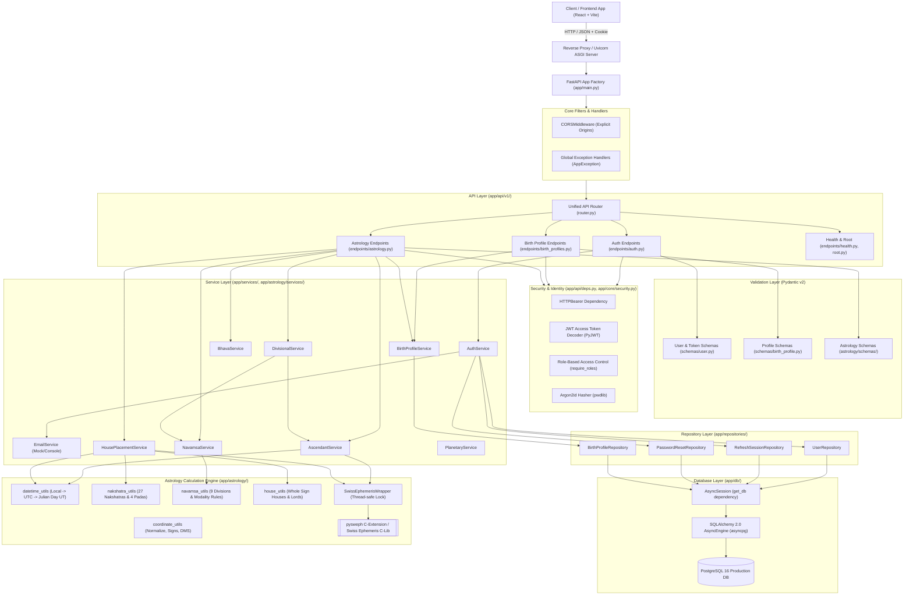
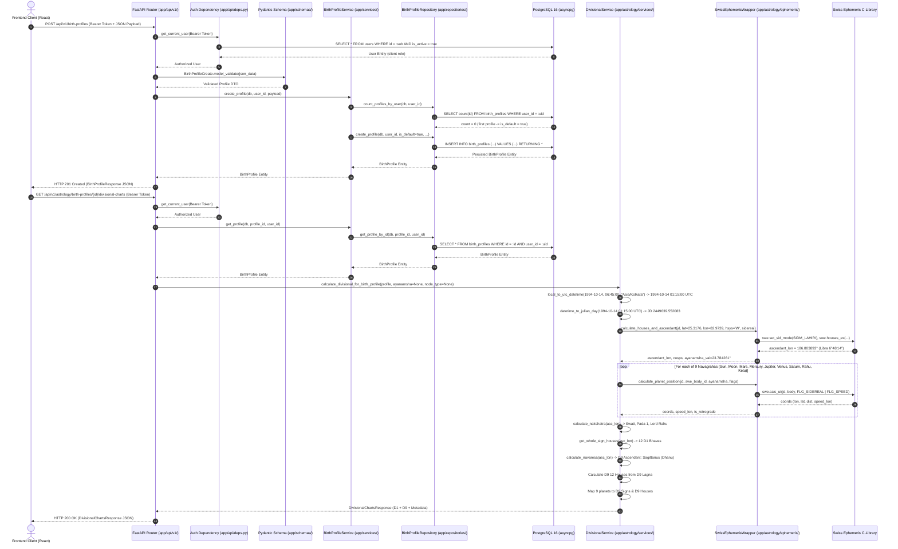
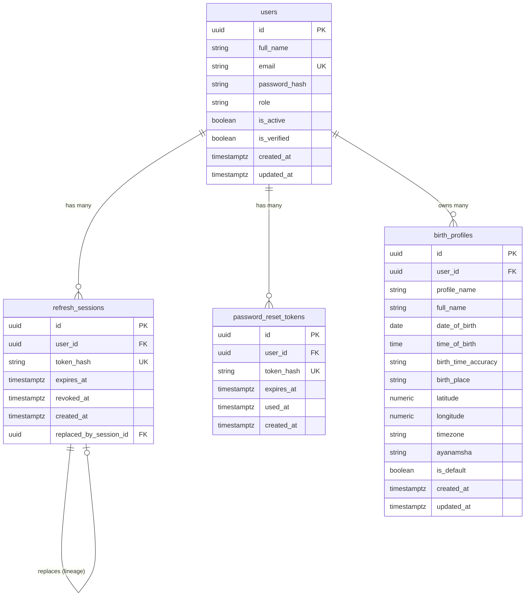

# Veda AI Backend: Complete Architecture, Codebase & Implementation Audit

**Audit Date**: November 24, 2026  
**Repository**: `veda-ai-backend`  
**Software Version**: `0.1.0`  
**Environment**: Production-Ready Architectural Review (Read-Only)  
**Total Automated Tests**: 105 Passed (100% Pass Rate across 9 test suites)

---

## Table of Contents
1. [Executive Summary](#1-executive-summary)
2. [Complete Implementation Inventory](#2-complete-implementation-inventory)
3. [Architecture Overview & Component Topology](#3-architecture-overview--component-topology)
4. [Complete Request Lifecycle Trace](#4-complete-request-lifecycle-trace)
5. [Astrology Calculation Engine: Internal Mechanics](#5-astrology-calculation-engine-internal-mechanics)
6. [Database Architecture & Entity Relationships](#6-database-architecture--entity-relationships)
7. [Comprehensive API Inventory](#7-comprehensive-api-inventory)
8. [Security Audit & Vulnerability Assessment](#8-security-audit--vulnerability-assessment)
9. [Testing, Verification & Deployment Status](#9-testing-verification--deployment-status)
10. [Gap Analysis, Missing Features & Technical Debt](#10-gap-analysis-missing-features--technical-debt)
11. [Developer Onboarding & Maintenance Guide](#11-developer-onboarding--maintenance-guide)
12. [Audit Conclusion & Strategic Roadmap](#12-audit-conclusion--strategic-roadmap)

---

## 1. Executive Summary

### 1.1 Purpose of the Audit
This technical audit provides an authoritative, code-verified, and deep-dive architectural analysis of the **Veda AI Backend** (`veda-ai-backend`). The audit inspects all production code, configurations, database models, data access repositories, domain services, Pydantic validation schemas, astronomical ephemeris wrappers, and automated test fixtures to evaluate system health, architectural integrity, and production readiness.

### 1.2 Technology Stack
The backend is an enterprise-grade asynchronous Python service constructed on:
- **Language Runtime**: Python 3.12+ (tested on Python 3.12 and 3.13)
- **Web Framework**: FastAPI `0.115.0+` (ASGI, Starlette-based, asynchronous)
- **ASGI Server**: Uvicorn `0.31.0+` with uvloop event loop
- **Relational Database Engine**: PostgreSQL 16 (production target); SQLite via `aiosqlite` (in-memory automated testing)
- **Object Relational Mapper (ORM)**: SQLAlchemy `2.0.35+` using async/await patterns (`ext.asyncio`)
- **Database Driver**: `asyncpg 0.30.0+` (high-performance binary protocol driver)
- **Schema Migrations**: Alembic `1.13.3+` (configured for async migrations)
- **Data Validation & Settings**: Pydantic `2.9.2+` and `pydantic-settings 2.5.2+`
- **Security & Cryptography**: `pwdlib[argon2] 0.4.2+` (Argon2id password hashing) and `PyJWT 2.9.0+` (HMAC-SHA256 access tokens)
- **Astronomical Calculation Engine**: `pysweph 2.10.3+` (Python C-extension bindings for the Astrodienst Swiss Ephemeris library)
- **Timezone Management**: Python standard library `zoneinfo` supported by `tzdata 2024.1+`
- **Containerization**: Docker multi-stage build on Debian `python:3.12-slim-bookworm` & Docker Compose v3.8

### 1.3 Key Architectural Strengths
1. **Separation of Concerns**: Strict multi-tier architecture isolating HTTP routing (`app/api/`), business services (`app/services/`), data access repositories (`app/repositories/`), persistence models (`app/db/models/`), and astronomical domain logic (`app/astrology/`).
2. **Deterministic Astronomical Calculations**: Astronomical calculations are computed purely at runtime using the C-level Swiss Ephemeris wrapper under thread-safe mutex locking (`threading.Lock`). Calculated charts are never persisted to the relational database, eliminating synchronization anomalies and cache staleness.
3. **Rigorous Multi-Tenant Isolation**: Every database query for birth profiles, refresh sessions, and password tokens is scoped strictly to the authenticated `user_id`. Attempting to access another user's resource yields HTTP `404 RESOURCE_NOT_FOUND` rather than a disclosure error.
4. **Resilient Security Lifecycle**: Full refresh token rotation with atomic Compare-and-Swap (CAS), token family lineage tracking, and automatic revocation of all user sessions upon detected token replay.

---

## 2. Complete Implementation Inventory

Each feature is classified based on source code inspection:
- **Verified**: Fully implemented in code and covered by automated tests.
- **Partial**: Implemented with limitations or missing external transport.
- **Mock/Placeholder**: Internal stub or in-memory simulation.
- **Not Implemented**: Deferred to future batches by design.

| Batch | Subsystem / Feature | Classification | Source File(s) | Key Class / Function |
|---|---|---|---|---|
| **6A** | FastAPI Application Factory & Lifespan | **Verified** | `app/main.py` | `lifespan()`, `app = FastAPI(...)` |
| **6A** | Central Configuration & Pydantic Settings | **Verified** | `app/core/config.py` | `class Settings(BaseSettings)` |
| **6A** | Async SQLAlchemy Engine & Session Pool | **Verified** | `app/db/session.py` | `engine`, `async_session_maker`, `get_db()` |
| **6A** | PostgreSQL Health Check Probe | **Verified** | `app/db/session.py` | `check_db_connectivity()` |
| **6A** | Root & Versioning Endpoints | **Verified** | `app/api/v1/endpoints/root.py` | `root_endpoint()`, `api_v1_root()` |
| **6A** | Database Health Endpoint | **Verified** | `app/api/v1/endpoints/health.py` | `health_check()` |
| **6A** | Global Exception Handlers | **Verified** | `app/main.py`, `app/core/exceptions.py` | `app_exception_handler()`, `AppException` |
| **6A** | Alembic Async Migration Environment | **Verified** | `alembic/env.py`, `alembic.ini` | `run_migrations_online()` |
| **6A** | Docker & Compose Setup | **Verified** | `Dockerfile`, `docker-compose.yml` | Multi-stage Dockerfile, PostgreSQL 16 container |
| **6B** | User Registration (`/auth/register`) | **Verified** | `app/services/auth_service.py` | `AuthService.register_user()` |
| **6B** | User Authentication (`/auth/login`) | **Verified** | `app/services/auth_service.py` | `AuthService.authenticate_user()` |
| **6B** | Argon2id Password Hashing | **Verified** | `app/core/security.py` | `get_password_hash()`, `verify_password()` |
| **6B** | JWT Access Token Minting & Verification | **Verified** | `app/core/security.py` | `create_access_token()`, `decode_access_token()` |
| **6B** | Refresh Token Rotation & Lineage Tracking | **Verified** | `app/services/auth_service.py` | `AuthService.refresh_tokens()` |
| **6B** | Refresh Replay Detection & Mass Revocation | **Verified** | `app/repositories/session_repository.py` | `RefreshSessionRepository.revoke_all_user_sessions()` |
| **6B** | Session Logout (`/auth/logout`) | **Verified** | `app/services/auth_service.py` | `AuthService.logout_session()` |
| **6B** | User Profile Endpoint (`/auth/me`) | **Verified** | `app/api/v1/endpoints/auth.py` | `get_me()` |
| **6B** | Password Recovery Request (`/forgot-password`) | **Partial** | `app/services/auth_service.py`, `app/services/email_service.py` | `AuthService.request_password_reset()` (Console/Mock email only) |
| **6B** | Password Reset Confirmation (`/reset-password`) | **Verified** | `app/services/auth_service.py` | `AuthService.reset_password()` |
| **6B** | Role-Based Authorization Dependencies | **Verified** | `app/api/deps.py` | `require_roles()`, `get_current_user()` |
| **6B** | Defense-in-Depth Cookie CSRF Validation | **Verified** | `app/api/v1/endpoints/auth.py` | Origin verification against `CORS_ORIGINS` |
| **6C** | Birth Profile Creation (`POST /birth-profiles`) | **Verified** | `app/services/birth_profile_service.py` | `BirthProfileService.create_profile()` |
| **6C** | Birth Profile Listing (`GET /birth-profiles`) | **Verified** | `app/repositories/birth_profile_repository.py` | `BirthProfileRepository.get_profiles_by_user()` |
| **6C** | Primary Default Profile (`GET /birth-profiles/default`)| **Verified** | `app/services/birth_profile_service.py` | `BirthProfileService.get_default_profile()` |
| **6C** | Profile Retrieval By ID (`GET /birth-profiles/{id}`) | **Verified** | `app/repositories/birth_profile_repository.py` | `BirthProfileRepository.get_profile_by_id()` |
| **6C** | Profile Updating (`PATCH /birth-profiles/{id}`) | **Verified** | `app/services/birth_profile_service.py` | `BirthProfileService.update_profile()` |
| **6C** | Profile Deletion & Auto-Re-election (`DELETE`) | **Verified** | `app/services/birth_profile_service.py` | `BirthProfileService.delete_profile()` |
| **6C** | Default Profile Designation (`PATCH .../default`) | **Verified** | `app/repositories/birth_profile_repository.py` | `BirthProfileRepository.set_default_profile()` |
| **6C** | Geographic Coordinate Validation | **Verified** | `app/schemas/birth_profile.py` | `validate_geo_latitude()`, `validate_geo_longitude()` |
| **6C** | IANA Timezone Validation | **Verified** | `app/schemas/birth_profile.py`, `app/core/timezones.py` | `validate_iana_timezone()`, `COMMON_IANA_TIMEZONES` |
| **6C** | Birth Time Accuracy Enforcement | **Verified** | `app/schemas/birth_profile.py` | Cross-field validator ensuring null time on 'unknown' |
| **6D-1** | Swiss Ephemeris C-Library Wrapper | **Verified** | `app/astrology/ephemeris/swiss_ephemeris.py` | `SwissEphemerisWrapper` |
| **6D-1** | Sidereal Nirayana Planetary Coordinates | **Verified** | `app/astrology/services/planetary_service.py` | `PlanetaryService.calculate_planetary_positions()` |
| **6D-1** | Multi-Ayanamsha Support (Lahiri, Raman, KP) | **Verified** | `app/astrology/constants.py` | `SWISSEPH_AYANAMSHA_MAP`, `AyanamshaSystem` |
| **6D-1** | Lunar Node Modes (True Node vs Mean Node) | **Verified** | `app/astrology/constants.py`, `app/astrology/services/planetary_service.py` | `NodeType.TRUE`, `NodeType.MEAN` |
| **6D-1** | Classical Navagraha (9 Bodies, Outer Planets Excluded)| **Verified**| `app/astrology/constants.py` | `NAVAGRAHA_BODIES` |
| **6D-1** | Rahu/Ketu 180° Symmetry Enforcement | **Verified** | `app/astrology/services/planetary_service.py` | Ketu calculated at `(rahu_lon + 180.0) % 360.0` |
| **6D-1** | Universal Time Julian Day (UT) Conversion | **Verified** | `app/astrology/utils/datetime_utils.py` | `datetime_to_julian_day()`, `local_to_utc_datetime()` |
| **6D-1** | Ephemeris File vs Moshier Analytical Fallback | **Verified** | `app/astrology/ephemeris/swiss_ephemeris.py` | `ASTROLOGY_REQUIRE_EPHEMERIS_FILES` setting check |
| **6D-1** | Engine Diagnostic Status (`GET .../engine/status`) | **Verified** | `app/api/v1/endpoints/astrology.py` | `get_engine_status()` |
| **6D-2** | Sidereal Ascendant (Lagna) Computation | **Verified** | `app/astrology/services/ascendant_service.py` | `AscendantService.calculate_ascendant()` |
| **6D-2** | 27 Nakshatras & 4 Padas Computation | **Verified** | `app/astrology/utils/nakshatra_utils.py` | `calculate_nakshatra()` |
| **6D-2** | Vimshottari 9-Lord Sequence Mapping | **Verified** | `app/astrology/constants.py`, `app/astrology/utils/nakshatra_utils.py` | `VIMSHOTTARI_LORDS`, `calculate_nakshatra()` |
| **6D-2** | 12 Whole Sign Bhavas Generation | **Verified** | `app/astrology/utils/house_utils.py`, `app/astrology/services/bhava_service.py` | `get_whole_sign_houses()`, `BhavaService.calculate_houses()` |
| **6D-2** | Classical Sign Lord Mapping (No Modern Outer Planets) | **Verified** | `app/astrology/constants.py`, `app/astrology/utils/house_utils.py` | `SIGN_LORDS`, `get_sign_lord()` |
| **6D-2** | Whole Sign Planet House Placement Formula | **Verified** | `app/astrology/utils/house_utils.py` | `get_planet_house()` |
| **6D-2** | Unified D1 Lagna Chart Endpoint (`GET .../lagna-chart`) | **Verified** | `app/api/v1/endpoints/astrology.py` | `get_birth_profile_lagna_chart()` |
| **6D-3** | D1 Rashi Chart Endpoint (`GET .../d1`) | **Verified** | `app/api/v1/endpoints/astrology.py` | `get_birth_profile_d1_chart()` |
| **6D-3** | Zodiac Modality Classification (Movable/Fixed/Dual) | **Verified** | `app/astrology/constants.py`, `app/astrology/utils/navamsa_utils.py` | `ZodiacModality`, `SIGN_MODALITIES`, `get_sign_modality()` |
| **6D-3** | Navamsa Start Sign Rules (Parashara Standard) | **Verified** | `app/astrology/utils/navamsa_utils.py` | `get_navamsa_start_sign()` |
| **6D-3** | 3°20' (200 Arcmin) Navamsa Division Math | **Verified** | `app/astrology/utils/navamsa_utils.py` | `calculate_navamsa()` |
| **6D-3** | D9 Navamsa Ascendant (Navamsa Lagna) | **Verified** | `app/astrology/services/navamsa_service.py` | `NavamsaService.build_d9_chart_from_placements()` |
| **6D-3** | D9 Whole Sign House Mapping (Independent from D1) | **Verified** | `app/astrology/services/navamsa_service.py` | House 1 = D9 Ascendant sign |
| **6D-3** | D9 Chart Endpoint (`GET .../d9`) | **Verified** | `app/api/v1/endpoints/astrology.py` | `get_birth_profile_d9_chart()` |
| **6D-3** | Combined Divisional Charts (`GET .../divisional-charts`)| **Verified**| `app/api/v1/endpoints/astrology.py`, `app/astrology/services/divisional_service.py` | `get_birth_profile_divisional_charts()` |

---

## 3. Architecture Overview & Component Topology

### 3.1 Architectural Philosophy
The backend follows clean layered architecture. Domain logic is strictly separated from data persistence and transport protocols. Business and calculation logic is agnostic to the presentation layer.



### 3.2 Layer-by-Layer Responsibilities

#### 1. API Routing Layer (`app/api/v1/endpoints/`)
- Exposes typed REST endpoints adhering to standard HTTP semantics.
- Decoupled from database transactions; depends on services and dependencies.
- Handles HTTP request parsing, query parameter extraction, and status code mapping.

#### 2. Authentication & Authorization Layer (`app/api/deps.py`, `app/core/security.py`)
- `get_current_user`: Resolves bearer JWT access tokens from HTTP headers, verifies cryptographic signatures, and queries the database for the active user entity. Rejects deactivated users (`UserInactiveError`).
- `require_roles`: Role-based access control factory (`client`, `astrologer`, `admin`).
- CSRF Origin Guard: Validates that browser cookie refresh/logout calls originate from trusted `CORS_ORIGINS`.

#### 3. Pydantic Validation Layer (`app/schemas/`, `app/astrology/schemas/`)
- Pydantic v2 schemas providing bidirectional JSON parsing, type casting, and schema validation.
- Validates geographic ranges ($-90^\circ \le \text{latitude} \le 90^\circ$, $-180^\circ \le \text{longitude} \le 180^\circ$).
- Validates IANA timezones via Python `zoneinfo` against standard Olson timezone databases.
- Enforces cross-field constraints (e.g. `time_of_birth` must be `None` if `birth_time_accuracy == 'unknown'`).

#### 4. Service Layer (`app/services/`, `app/astrology/services/`)
- Implements core business logic and cross-model workflows.
- Manages atomic transactions, rotation lineage, and user notifications.
- Pure calculation services in `app/astrology/services/` transform astronomical coordinates into Vedic Bhavas and divisional charts.

#### 5. Repository Layer (`app/repositories/`)
- Encapsulates database queries using SQLAlchemy 2.0 select and update expressions.
- Guarantees strict multi-tenant isolation by requiring `user_id` on all record queries.
- Manages row-level concurrency locking using `.with_for_update()`.

#### 6. Database Layer (`app/db/`)
- Manages the asynchronous SQLAlchemy connection pool (`pool_pre_ping=True`, `pool_size=10`, `max_overflow=20`).
- Provides asynchronous session injection via `get_db()`.
- Implements automatic transactional rollback on unhandled exceptions.

#### 7. Astronomical Computation Engine (`app/astrology/`)
- Wraps the Swiss Ephemeris C-library via `pysweph`.
- Converts localized timestamps to UTC and computes Universal Time Julian Days.
- Evaluates sidereal positions using Lahiri, Raman, or Krishnamurti ayanamshas.
- Calculates Whole Sign houses, Nakshatras, Padas, and Navamsas at runtime.

---

## 4. Complete Request Lifecycle Trace

To illustrate how data travels across all backend layers, this trace follows an authenticated user submitting birth details and requesting their D1 and D9 charts.

### Example Scenario
- **User**: Authenticated client `Aarav Sharma` (`user_id = 4b68434f-f06b-4899-b1ba-10e527f62e84`)
- **Native Details**: Born October 14, 1994, at 06:45:00 IST in Varanasi, India ($25.3176^\circ\text{ N}, 82.9739^\circ\text{ E}$).
- **Target Operations**:
  1. `POST /api/v1/birth-profiles` (Create Birth Profile)
  2. `GET /api/v1/astrology/birth-profiles/{id}/divisional-charts` (Calculate D1 and D9 Charts)



### Detailed Execution Steps

| Step | Layer | File & Function | Operation Details |
|---|---|---|---|
| **1** | Transport | `app/main.py:app` | Client issues `POST /api/v1/birth-profiles` with JSON body and `Authorization: Bearer <token>`. |
| **2** | Security | `app/api/deps.py:get_current_user` | Decodes JWT, validates `exp`, parses `sub` UUID, and executes `UserRepository.get_by_id(db, user_id)`. Verifies `is_active == True`. |
| **3** | Validation | `app/schemas/birth_profile.py:BirthProfileCreate` | Validates `date_of_birth` (not in future), `latitude` ($-90^\circ \le \text{lat} \le 90^\circ$), `longitude` ($-180^\circ \le \text{lon} \le 180^\circ$), and `timezone` via Python `zoneinfo`. |
| **4** | Service | `app/services/birth_profile_service.py:create_profile` | Checks existing profile count. Since count is 0, auto-assigns `is_default = True`. |
| **5** | Repository | `app/repositories/birth_profile_repository.py:create_profile` | Adds `BirthProfile` to `AsyncSession`, flushes to PostgreSQL database, and refreshes attributes. |
| **6** | Client | `app/api/v1/endpoints/astrology.py:get_birth_profile_divisional_charts` | Client calls `GET /api/v1/astrology/birth-profiles/{id}/divisional-charts`. |
| **7** | Security | `app/repositories/birth_profile_repository.py:get_profile_by_id` | Verifies user ownership via `WHERE id = :id AND user_id = :uid`. Returns 404 if profile is missing or owned by another user. |
| **8** | Time Conversion | `app/astrology/utils/datetime_utils.py:local_to_utc_datetime` | Localizes `1994-10-14 06:45:00` in `Asia/Kolkata` (UTC+05:30) and converts to `1994-10-14 01:15:00 UTC`. |
| **9** | Astronomical Math | `app/astrology/utils/datetime_utils.py:datetime_to_julian_day` | Converts UTC datetime to Julian Day Universal Time: `JD = 2449639.552083`. |
| **10** | Ephemeris | `app/astrology/ephemeris/swiss_ephemeris.py:calculate_houses_and_ascendant` | Acquires `_SWE_LOCK`, sets `SE_SIDM_LAHIRI`, and calls `swe.houses_ex(jd, 25.3176, 82.9739, b'W', FLG_SIDEREAL)`. |
| **11** | Ephemeris | `app/astrology/ephemeris/swiss_ephemeris.py:calculate_planet_position` | Iterates over 9 Navagrahas. Computes sidereal longitudes and longitudinal daily speeds (`FLG_SPEED`). |
| **12** | Domain Logic | `app/astrology/utils/coordinate_utils.py:get_zodiac_sign` | Normalizes longitudes ($0^\circ \text{ to } <360^\circ$). Computes zodiac sign ($1\text{ to }12$) and degrees within sign ($0^\circ \text{ to } <30^\circ$). |
| **13** | Domain Logic | `app/astrology/utils/nakshatra_utils.py:calculate_nakshatra` | Computes Nakshatra ($1\text{ to }27$), Pada ($1\text{ to }4$), and Vimshottari ruler. |
| **14** | Domain Logic | `app/astrology/utils/house_utils.py:get_whole_sign_houses` | Assigns Ascendant sign to House 1. Rotates subsequent signs through House 12. Assigns classical lords. |
| **15** | Domain Logic | `app/astrology/utils/navamsa_utils.py:calculate_navamsa` | Determines sign modality (Movable/Fixed/Dual), starting sign, and Navamsa index ($0\text{ to }8$). Computes D9 signs. |
| **16** | Domain Logic | `app/astrology/services/navamsa_service.py:build_d9_chart_from_placements` | Assigns D9 Ascendant sign to D9 House 1. Maps planetary D9 signs to D9 houses independently of D1. |
| **17** | Serialization | `app/astrology/schemas/divisional.py:DivisionalChartsResponse` | Validates complete D1 and D9 structures against Pydantic schema and returns HTTP 200 JSON. |

---

## 5. Astrology Calculation Engine: Internal Mechanics

The astrology calculation engine in `app/astrology/` follows classical Vedic Jyotish principles (Parashara System) combined with modern astronomical ephemerides.

### 5.1 Planetary Positions & Swiss Ephemeris
- **Underlying Engine**: Astrodienst Swiss Ephemeris (C-library) accessed via `pysweph`. It implements the numerical integration models of JPL (Jet Propulsion Laboratory) DE431.
- **Sidereal Nirayana Reference**: Unlike Western astrology which uses the tropical (Sayana) moving equinox, Vedic Jyotish uses the sidereal fixed star framework. The engine applies the sidereal flag `swe.FLG_SIDEREAL`.
- **Ayanamsha Systems**:
  1. **Lahiri (Chitrapaksha / `SE_SIDM_LAHIRI`)**: Standard ayanamsha recognized by the Government of India Calendar Reform Committee ($23^\circ 47' 03''$ for J2000.0). Default in Veda AI.
  2. **B.V. Raman (`SE_SIDM_RAMAN`)**: Classical South Indian ayanamsha ($22^\circ 20'$ for J2000.0, approximately $1^\circ 27'$ lower than Lahiri).
  3. **Krishnamurti Paddhati (`SE_SIDM_KRISHNAMURTI`)**: KP System stellar ayanamsha based on Newcomb's precession with Chitrapaksha zero point.
- **Lunar Nodes (Rahu and Ketu)**:
  - **True Node (`SE_TRUE_NODE`)**: The exact instantaneous astronomical intersection of lunar orbit and ecliptic, accounting for gravitational perturbations. True Node experiences periodic direct motion.
  - **Mean Node (`SE_MEAN_NODE`)**: The idealized, uniformly moving mathematical average node. Always retrograde.
  - **Ketu Position**: Ketu is calculated as the exact $180^\circ$ opposite point of Rahu:
    $$\lambda_{\text{Ketu}} = (\lambda_{\text{Rahu}} + 180^\circ) \pmod{360^\circ}$$
    Its speed and retrograde status match Rahu, ensuring astronomical symmetry.
- **Retrograde Status (Vakri)**:
  Computed via longitudinal daily speed vector (`coords[3]` in degrees/day):
  $$\text{is\_retrograde} = (\text{speed\_longitude} < 0.0)$$
- **Ephemeris Modes & Fallback**:
  - **High-Precision Swiss Ephemeris (`.se1`)**: When `.se1` files (`sepl_18.se1`, `semo_18.se1`) are mounted in `SWISS_EPHEMERIS_PATH`, Swiss Ephemeris achieves $0.001\text{ arcsecond}$ precision.
  - **Built-in Moshier Analytical Ephemeris**: When `.se1` files are not present on disk, the C library automatically falls back to Robert Moshier's analytical ephemeris algorithm (precision $0.1\text{ arcsecond}$ for planets, $1\text{--}3\text{ arcseconds}$ for Moon). This ensures zero deployment crashes while preserving astronomical accuracy.
  - **Strict Mode**: If `ASTROLOGY_REQUIRE_EPHEMERIS_FILES=true`, the engine raises `EphemerisUnavailableError` (HTTP 503) instead of falling back to Moshier.

### 5.2 Ascendant (Lagna) Computation
- **Astronomical Definition**: The Ascendant is the degree of the ecliptic rising above the eastern horizon at the local birth instant and geographic coordinates.
- **Geographic Dependence**:
  Calculated using local geographic latitude $\phi$ and longitude $\lambda$:
  $$\text{RAMC} = \text{GMST} + \lambda$$
  Swiss Ephemeris calculates the right ascension of the meridian (RAMC) and applies true ecliptic obliquity $\epsilon$ and nutation.
- **C-Level Method**:
  ```python
  cusps, ascmc = swe.houses_ex(julian_day_ut, latitude, longitude, b'W', swe.FLG_SIDEREAL)
  ascendant_longitude = ascmc[0] % 360.0
  ```
  Calling `swe.houses_ex` with `swe.FLG_SIDEREAL` applies the sidereal ayanamsha transformation at the C-level before horizon projection.

### 5.3 Nakshatra and Pada Computation
The sidereal ecliptic ($360^\circ$) is divided into 27 Nakshatras (Lunar Mansions). Each Nakshatra spans:
$$\text{Span}_{\text{Nakshatra}} = \frac{360^\circ}{27} = 13^\circ 20' = 800.0\text{ arcminutes}$$

Each Nakshatra is divided into 4 equal quarters (Padas):
$$\text{Span}_{\text{Pada}} = \frac{13^\circ 20'}{4} = 3^\circ 20' = 200.0\text{ arcminutes}$$

There are $27 \times 4 = 108$ Padas across the zodiac.

```
Total Arcminutes = (Normalized Longitude) * 60.0
Nakshatra Index  = floor(Total Arcminutes / 800.0)      (0 to 26)
Pada             = floor((Total Arcminutes % 800.0) / 200.0) + 1  (1 to 4)
Vimshottari Lord = VIMSHOTTARI_LORDS[Nakshatra Index % 9]
```
The Vimshottari ruler sequence repeats every 9 Nakshatras:
*Ketu, Venus, Sun, Moon, Mars, Rahu, Jupiter, Saturn, Mercury*.

### 5.4 Twelve Whole Sign Bhavas (Houses)
Under the classical Vedic Whole Sign house system (used by Sage Parashara):
- The entire $30^\circ$ zodiac sign containing the Ascendant degree is designated as **Bhava 1** (House 1 / Lagna).
- The subsequent sign forms House 2, continuing cyclically through House 12.
- A planet's house placement is determined by its zodiac sign relative to the Ascendant sign:
  $$\text{House} = ((\text{Planet Sign} - \text{Ascendant Sign}) \pmod{12}) + 1$$
- **Sign Lords**: Classical rulership without modern outer planets:
  - Aries, Scorpio: Mars (*Mangala*)
  - Taurus, Libra: Venus (*Shukra*)
  - Gemini, Virgo: Mercury (*Budha*)
  - Cancer: Moon (*Chandra*)
  - Leo: Sun (*Surya*)
  - Sagittarius, Pisces: Jupiter (*Guru*)
  - Capricorn, Aquarius: Saturn (*Shani*)

### 5.5 D1 Rashi (Natal) Chart
- Represents the primary natal chart (D1) mapping planets into the 12 Whole Sign Bhavas.
- Assembled by `LagnaChartService` and `DivisionalService`.
- Combines sidereal Ascendant, 12 Bhavas, and 9 Navagrahas with house numbers, retrograde status, and Nakshatra/Pada details.

### 5.6 D9 Navamsa Chart Mathematics
The Navamsa chart (D9) is the ninth harmonic divisional chart ($1/9\text{th}$ division of each sign). Each Navamsa division measures $3^\circ 20'$ ($200.0\text{ arcminutes}$).

#### Sign-Start Rules (Quadruplicity / Modality)
1. **Movable Signs (Chara)**: Aries (1), Cancer (4), Libra (7), Capricorn (10)
   - Sequence starts from the sign itself:
     $$\text{start\_sign} = \text{sign}$$
2. **Fixed Signs (Sthira)**: Taurus (2), Leo (5), Scorpio (8), Aquarius (11)
   - Sequence starts from the 9th sign from that sign:
     $$\text{start\_sign} = ((\text{sign} - 1 + 8) \pmod{12}) + 1$$
3. **Dual Signs (Dvisvabhava)**: Gemini (3), Virgo (6), Sagittarius (9), Pisces (12)
   - Sequence starts from the 5th sign from that sign:
     $$\text{start\_sign} = ((\text{sign} - 1 + 4) \pmod{12}) + 1$$

#### Mathematical Derivation of D9 Sign
```
arcmin_in_sign = (longitude % 30.0) * 60.0
navamsa_index  = floor(arcmin_in_sign / 200.0)        (0 to 8)
d9_sign        = ((start_sign - 1 + navamsa_index) % 12) + 1
```

#### Degree Scaling within D9 Sign
The $3^\circ 20'$ ($200\text{ arcmin}$) slice expands to a full $30^\circ$ zodiac sign in D9:
$$\text{deg\_in\_d9\_sign} = \frac{\text{arcmin\_in\_sign} - (\text{navamsa\_index} \times 200.0)}{200.0} \times 30.0$$

#### Independent D9 House Placement
- The D9 Ascendant sign becomes **House 1** of the D9 chart (Navamsa Lagna).
- D9 houses are constructed using the Whole Sign system starting from Navamsa Lagna.
- Each planet's D9 house number is calculated relative to the D9 Ascendant:
  $$\text{d9\_house} = ((\text{planet\_d9\_sign} - \text{d9\_asc\_sign}) \pmod{12}) + 1$$
- D1 house numbers are never reused for D9 placements.

---

## 6. Database Architecture & Entity Relationships

### 6.1 Database Models & Specifications

#### 1. `users` Table
Managed by `app/db/models/user.py`.

| Column | Data Type | Nullable | Default | Constraints & Indexes |
|---|---|---|---|---|
| `id` | `UUID` | No | `uuid.uuid4` | Primary Key |
| `full_name` | `VARCHAR(255)` | No | - | - |
| `email` | `VARCHAR(255)` | No | - | Unique Index (`ix_users_email`) |
| `password_hash` | `VARCHAR(255)` | No | - | Argon2id Hash |
| `role` | `VARCHAR(50)` | No | `'client'` | Check: `role IN ('client', 'astrologer', 'admin')` |
| `is_active` | `BOOLEAN` | No | `TRUE` | Server Default `true` |
| `is_verified` | `BOOLEAN` | No | `FALSE` | Server Default `false` |
| `created_at` | `TIMESTAMPTZ` | No | `now()` | Timezone-aware timestamp |
| `updated_at` | `TIMESTAMPTZ` | No | `now()` | Timezone-aware timestamp |

#### 2. `refresh_sessions` Table
Managed by `app/db/models/refresh_session.py`.

| Column | Data Type | Nullable | Default | Constraints & Indexes |
|---|---|---|---|---|
| `id` | `UUID` | No | `uuid.uuid4` | Primary Key |
| `user_id` | `UUID` | No | - | Foreign Key $\to$ `users.id` (`ON DELETE CASCADE`), Index (`ix_refresh_sessions_user_id`) |
| `token_hash` | `VARCHAR(64)` | No | - | SHA-256 Hash, Unique Index (`ix_refresh_sessions_token_hash`) |
| `expires_at` | `TIMESTAMPTZ` | No | - | Session Expiration Timestamp |
| `revoked_at` | `TIMESTAMPTZ` | Yes | `NULL` | Nullable Revocation Timestamp |
| `created_at` | `TIMESTAMPTZ` | No | `now()` | Session Creation Timestamp |
| `replaced_by_session_id` | `UUID` | Yes | `NULL` | Foreign Key $\to$ `refresh_sessions.id` (`ON DELETE SET NULL`) |

#### 3. `password_reset_tokens` Table
Managed by `app/db/models/password_reset_token.py`.

| Column | Data Type | Nullable | Default | Constraints & Indexes |
|---|---|---|---|---|
| `id` | `UUID` | No | `uuid.uuid4` | Primary Key |
| `user_id` | `UUID` | No | - | Foreign Key $\to$ `users.id` (`ON DELETE CASCADE`), Index (`ix_password_reset_tokens_user_id`) |
| `token_hash` | `VARCHAR(64)` | No | - | SHA-256 Hash, Unique Index (`ix_password_reset_tokens_token_hash`) |
| `expires_at` | `TIMESTAMPTZ` | No | - | Token Expiration Timestamp |
| `used_at` | `TIMESTAMPTZ` | Yes | `NULL` | Single-use Consumption Timestamp |
| `created_at` | `TIMESTAMPTZ` | No | `now()` | Creation Timestamp |

#### 4. `birth_profiles` Table
Managed by `app/db/models/birth_profile.py`.

| Column | Data Type | Nullable | Default | Constraints & Indexes |
|---|---|---|---|---|
| `id` | `UUID` | No | `uuid.uuid4` | Primary Key |
| `user_id` | `UUID` | No | - | Foreign Key $\to$ `users.id` (`ON DELETE CASCADE`), Index (`ix_birth_profiles_user_id`) |
| `profile_name` | `VARCHAR(100)` | No | - | User-defined profile label |
| `full_name` | `VARCHAR(150)` | No | - | Native legal or birth name |
| `date_of_birth` | `DATE` | No | - | YYYY-MM-DD format |
| `time_of_birth` | `TIME` | Yes | `NULL` | HH:MM:SS format (null if accuracy is unknown) |
| `birth_time_accuracy` | `VARCHAR(20)` | No | `'exact'` | Check: `IN ('exact', 'approximate', 'unknown')` |
| `birth_place` | `VARCHAR(255)` | No | - | City, State, Country location string |
| `latitude` | `NUMERIC(10, 7)` | Yes | `NULL` | Check: `IS NULL OR (latitude >= -90.0 AND latitude <= 90.0)` |
| `longitude` | `NUMERIC(10, 7)` | Yes | `NULL` | Check: `IS NULL OR (longitude >= -180.0 AND longitude <= 180.0)` |
| `timezone` | `VARCHAR(100)` | Yes | `NULL` | IANA Timezone identifier (e.g. `'Asia/Kolkata'`) |
| `ayanamsha` | `VARCHAR(20)` | No | `'lahiri'` | Check: `IN ('lahiri', 'raman', 'kp')` |
| `is_default` | `BOOLEAN` | No | `FALSE` | Partial Unique Index: at most one default profile per user (`uq_birth_profiles_user_default`) |
| `created_at` | `TIMESTAMPTZ` | No | `now()` | Profile Creation Timestamp |
| `updated_at` | `TIMESTAMPTZ` | No | `now()` | Profile Update Timestamp |

### 6.2 Entity-Relationship (ER) Diagram



### 6.3 Database Consistency & Index Analysis
1. **Model vs Migration Alignment**:
   The two Alembic migrations (`0001_initial_auth` and `0002_create_birth_profiles`) match the declarative models in `app/db/models/`.
2. **Partial Unique Index Implementation**:
   In `birth_profiles.py`, the unique index enforcing at most one default profile per user supports both PostgreSQL (`postgresql_where="is_default = true"`) and SQLite (`sqlite_where="is_default = 1"`), allowing SQLite in-memory test suites to execute without syntax failure.
3. **Potential Optimization Opportunities**:
   - `refresh_sessions` and `password_reset_tokens` currently lack compound indexes on `(user_id, expires_at)` for high-throughput session cleanup operations.
   - A scheduled cleanup job for expired sessions and used tokens is recommended to prevent table bloat.

---

## 7. Comprehensive API Inventory

Every endpoint in the application router (`app/api/v1/router.py`) is documented below with input parameters, response models, and error responses.

### 7.1 System & Diagnostic Endpoints

#### `GET /`
- **Summary**: Root System Information
- **Auth**: None
- **Response**: `{ "app_name": str, "version": str, "environment": str, "status": "online", "api_v1": str, "documentation": dict }`

#### `GET /api/v1/`
- **Summary**: API v1 Metadata
- **Auth**: None
- **Response**: `{ "api_version": "v1", "status": "active", ... }`

#### `GET /api/v1/health`
- **Summary**: Health Check Probe
- **Auth**: None
- **Response**: `HealthResponse` (`200 OK` when connected, `503 Service Unavailable` when database is down)

#### `GET /api/v1/astrology/engine/status`
- **Summary**: Astrology Engine Diagnostics
- **Auth**: Bearer JWT (Any authenticated user)
- **Response Model**: `AstrologyEngineStatusResponse`
- **Response Example**:
  ```json
  {
    "engine_name": "Swiss Ephemeris",
    "engine_available": true,
    "engine_version": "2.10.03",
    "astrology_system": "vedic",
    "zodiac_type": "sidereal",
    "default_ayanamsha": "lahiri",
    "default_house_system": "whole_sign",
    "node_type": "true",
    "ephemeris_path_configured": false,
    "ephemeris_files_available": false,
    "ephemeris_mode": "moshier_analytical",
    "supported_celestial_bodies": ["sun", "moon", "mars", "mercury", "jupiter", "venus", "saturn", "rahu", "ketu"],
    "supported_ayanamshas": ["lahiri", "raman", "kp"]
  }
  ```

---

### 7.2 Authentication Endpoints (`/api/v1/auth`)

| Method | URL | Auth | Request Body | Response Model | Description |
|---|---|---|---|---|---|
| `POST` | `/api/v1/auth/register` | None | `UserRegister` | `UserResponse` (`201 Created`) | Registers new user account with `client` role. Rejects duplicate emails (`409 Conflict`). |
| `POST` | `/api/v1/auth/login` | None | `UserLogin` | `TokenResponse` (`200 OK`) | Validates credentials; issues JWT access token and sets HTTP-only refresh cookie. |
| `POST` | `/api/v1/auth/refresh` | None | `RefreshTokenRequest` (optional if cookie present) | `TokenResponse` (`200 OK`) | Rotates refresh token; detects token replay. |
| `POST` | `/api/v1/auth/logout` | None | `RefreshTokenRequest` (optional if cookie present) | `AuthMessageResponse` (`200 OK`) | Revokes refresh token and clears session cookies. |
| `GET` | `/api/v1/auth/me` | Bearer JWT | None | `UserResponse` (`200 OK`) | Returns current user profile and role claims. |
| `POST` | `/api/v1/auth/forgot-password` | None | `ForgotPasswordRequest` | `AuthMessageResponse` (`200 OK`) | Generates password recovery token. Always returns generic message to prevent enumeration. |
| `POST` | `/api/v1/auth/reset-password` | None | `ResetPasswordRequest` | `AuthMessageResponse` (`200 OK`) | Validates single-use token; resets password and revokes all active sessions. |

---

### 7.3 Birth Profile Endpoints (`/api/v1/birth-profiles`)

All birth profile endpoints require a valid Bearer JWT access token and enforce strict user ownership.

| Method | URL | Auth | Request Body | Response Model | Description |
|---|---|---|---|---|---|
| `POST` | `/api/v1/birth-profiles` | Bearer JWT | `BirthProfileCreate` | `BirthProfileResponse` (`201 Created`) | Creates a birth profile. First profile is auto-designated default. |
| `GET` | `/api/v1/birth-profiles` | Bearer JWT | None | `BirthProfileListResponse` (`200 OK`) | Lists owned birth profiles, default profile first. |
| `GET` | `/api/v1/birth-profiles/default` | Bearer JWT | None | `BirthProfileResponse` (`200 OK`) | Retrieves user's default birth profile (`404` if none). |
| `GET` | `/api/v1/birth-profiles/{id}` | Bearer JWT | None | `BirthProfileResponse` (`200 OK`) | Retrieves specific birth profile (`404` if not found or unauthorized). |
| `PATCH` | `/api/v1/birth-profiles/{id}` | Bearer JWT | `BirthProfileUpdate` | `BirthProfileResponse` (`200 OK`) | Updates profile fields with cross-field validation. |
| `DELETE` | `/api/v1/birth-profiles/{id}` | Bearer JWT | None | `BirthProfileMessageResponse` (`200 OK`) | Deletes profile. Auto-elects a new default profile if the deleted one was default. |
| `PATCH` | `/api/v1/birth-profiles/{id}/default` | Bearer JWT | None | `BirthProfileResponse` (`200 OK`) | Atomically sets profile as the user's default. |

---

### 7.4 Astrology & Divisional Chart Endpoints (`/api/v1/astrology`)

All endpoints below require a valid Bearer JWT, enforce profile ownership, and accept optional query parameters:
- `ayanamsha`: `lahiri` (default), `raman`, or `kp`
- `node_type`: `true` (default True Node) or `mean` (Mean Node)

| Method | URL | Summary | Response Model |
|---|---|---|---|
| `GET` | `/api/v1/astrology/birth-profiles/{id}/lagna` | Ascendant (Lagna) | `AscendantResponse` |
| `GET` | `/api/v1/astrology/birth-profiles/{id}/houses` | 12 Whole Sign Bhavas | `HouseChartResponse` |
| `GET` | `/api/v1/astrology/birth-profiles/{id}/planetary-placements` | 9 Navagraha Placements | `PlanetaryPlacementsResponse` |
| `GET` | `/api/v1/astrology/birth-profiles/{id}/lagna-chart` | Unified D1 Chart | `LagnaChartResponse` |
| `GET` | `/api/v1/astrology/birth-profiles/{id}/d1` | D1 Rashi Chart | `D1ChartResponse` |
| `GET` | `/api/v1/astrology/birth-profiles/{id}/d9` | D9 Navamsa Chart | `D9ChartResponse` |
| `GET` | `/api/v1/astrology/birth-profiles/{id}/divisional-charts` | Combined D1 & D9 | `DivisionalChartsResponse` |

---

## 8. Security Audit & Vulnerability Assessment

### 8.1 Evaluated Security Controls
1. **Password Hashing**: Implemented via Argon2id through `pwdlib[argon2]`. Argon2id is the state-of-the-art memory-hard hashing algorithm resistant to GPU and ASIC brute-force attacks.
2. **Access Token Lifecycle**: HMAC-SHA256 JWT access tokens configured with a default lifetime of 30 minutes. Tokens carry identity (`sub`) and role claims.
3. **Refresh Token Security**:
   - High-entropy cryptographic random strings generated via Python `secrets.token_urlsafe(48)`.
   - Stored in the database as SHA-256 hashes (`token_hash`), so a database dump does not expose usable refresh tokens.
   - Full token rotation: each refresh issues a new token and marks the previous token revoked.
   - Replay detection: reusing a revoked refresh token triggers immediate invalidation of all active sessions for that user.
4. **Cookie Security**:
   - `HttpOnly`: Prevents client-side JavaScript access and protects against XSS token exfiltration.
   - `SameSite=Lax`: Mitigates Cross-Site Request Forgery (CSRF).
   - `Path=/api/v1/auth`: Restricts cookie transmission strictly to authentication endpoints.
   - In production (`APP_ENV=production`), `COOKIE_SECURE=True` is enforced via Pydantic model validation.
5. **CSRF Protection**: For cookie-based refresh and logout requests, the application validates the HTTP `Origin` header against `CORS_ORIGINS`.
6. **SQL Injection Defense**: All database operations use SQLAlchemy 2.0 ORM expressions and parameterized statements.
7. **Cross-Tenant Data Isolation**: Database repositories enforce `WHERE user_id = :uid` on every birth profile and session operation. Access attempts across users return `404 RESOURCE_NOT_FOUND`.

### 8.2 Security Findings & Risk Classification

| ID | Category | Severity | Description | Status / Remediation |
|---|---|---|---|---|
| **SEC-01** | Abuse Prevention | **Medium** | Authentication endpoints (`/auth/login`, `/auth/refresh`, `/auth/forgot-password`) lack rate-limiting / brute-force throttling middleware (e.g. slowapi). | **Recommendation**: Implement Redis-backed token bucket rate limiting (e.g. 5 attempts/minute). |
| **SEC-02** | Session Hygiene | **Low** | Expired refresh sessions and used password tokens remain in PostgreSQL indefinitely. | **Recommendation**: Add a scheduled background task or cron job to prune records past `expires_at`. |
| **SEC-03** | Communication | **Low** | `EmailService` is configured for development console or testing mock outbox; external SMTP transport is not yet connected. | **Expected**: Transactional email integration planned for subsequent notification batches. |
| **SEC-04** | Configuration | **Informational** | `Settings.validate_production_security` actively blocks development defaults (e.g. `DEBUG=True`, insecure secrets, wildcard CORS) if `APP_ENV=production`. | **Verified**: Production safeguards verified by 5 dedicated automated tests in `test_security_audit.py`. |

---

## 9. Testing, Verification & Deployment Status

### 9.1 Test Suite Breakdown
The test suite consists of **105 automated tests** across 9 test files, with a 100% pass rate.

| Test File | Modules Tested | Test Count | Execution Result |
|---|---|---|---|
| [tests/test_astrology_engine.py](file:///c:/Users/shiva/Desktop/FreeLance_veda/veda-ai/veda-ai-backend/tests/test_astrology_engine.py) | Batch 6D-1: Ephemeris wrapper, planetary positions, ayanamshas, True/Mean nodes, Moshier fallback, diagnostics | 18 | **18 Passed** |
| [tests/test_auth.py](file:///c:/Users/shiva/Desktop/FreeLance_veda/veda-ai/veda-ai-backend/tests/test_auth.py) | Batch 6B: Registration, login, password hashing, token rotation, logout, me, password reset | 13 | **13 Passed** |
| [tests/test_birth_profiles.py](file:///c:/Users/shiva/Desktop/FreeLance_veda/veda-ai/veda-ai-backend/tests/test_birth_profiles.py) | Batch 6C: Birth profile CRUD, ownership isolation, default profile lifecycle, accuracy rules, coordinates | 16 | **16 Passed** |
| [tests/test_config.py](file:///c:/Users/shiva/Desktop/FreeLance_veda/veda-ai/veda-ai-backend/tests/test_config.py) | Batch 6A: Pydantic Settings, CORS assembly, database URL parsing, exception mapping | 5 | **5 Passed** |
| [tests/test_d1_and_d9_charts.py](file:///c:/Users/shiva/Desktop/FreeLance_veda/veda-ai/veda-ai-backend/tests/test_d1_and_d9_charts.py) | Batch 6D-3: Sign modalities, Navamsa start rules, 3°20' boundaries, D1/D9 endpoints, Varanasi benchmark | 13 | **13 Passed** |
| [tests/test_health.py](file:///c:/Users/shiva/Desktop/FreeLance_veda/veda-ai/veda-ai-backend/tests/test_health.py) | Batch 6A: System health check, database connectivity probe handling, latency metrics | 3 | **3 Passed** |
| [tests/test_lagna_and_bhavas.py](file:///c:/Users/shiva/Desktop/FreeLance_veda/veda-ai/veda-ai-backend/tests/test_lagna_and_bhavas.py) | Batch 6D-2: Ascendant calculation, 27 Nakshatras & 4 Padas, Whole Sign Bhavas, lords, Lagna chart | 17 | **17 Passed** |
| [tests/test_root.py](file:///c:/Users/shiva/Desktop/FreeLance_veda/veda-ai/veda-ai-backend/tests/test_root.py) | Batch 6A: Root metadata, OpenAPI documentation endpoints (Swagger / Redoc) | 4 | **4 Passed** |
| [tests/test_security_audit.py](file:///c:/Users/shiva/Desktop/FreeLance_veda/veda-ai/veda-ai-backend/tests/test_security_audit.py) | Batch 6B: Concurrent refresh rotation safety, replay detection, cookie security, CSRF guard, production config | 16 | **16 Passed** |
| **Total** | **All Modules (Batches 6A through 6D-3)** | **105** | **105 Passed (100%)** |

### 9.2 Testing Environment vs. Production Database
- **Automated Tests**: Execute against an in-memory asynchronous SQLite database (`sqlite+aiosqlite:///:memory:`) using FastAPI dependency overrides (`app.dependency_overrides[get_db]`). SQLite is fast, fully isolated, and self-cleaning.
- **PostgreSQL 16 Differences**:
  - In PostgreSQL, row-level locks (`with_for_update()`) lock specific rows, whereas SQLite applies table-level locks.
  - Partial unique indexes in PostgreSQL evaluate Boolean literals (`is_default = true`), while SQLite evaluates integer expressions (`is_default = 1`). Both cases are supported via `postgresql_where` and `sqlite_where` definitions in `app/db/models/birth_profile.py`.
- **Live Database Integration Testing**:
  Automated tests do not run against a live PostgreSQL database by default. Full integration testing against PostgreSQL occurs in CI/CD environments where the `db` service is spun up via Docker Compose.

---

## 10. Gap Analysis, Missing Features & Technical Debt

### 10.1 Incomplete Features & Missing Integrations
1. **Production Transactional Email Integration**:
   `app/services/email_service.py` currently logs password reset tokens to the development console (`EMAIL_PROVIDER="console"`) or appends them to an in-memory list during testing (`TEST_OUTBOX`). An external transport (e.g. SendGrid, Resend, or AWS SES) has not yet been integrated.
2. **Expired Token Housekeeping**:
   Expired `refresh_sessions` and consumed `password_reset_tokens` remain in the database indefinitely. A background maintenance job should be added to delete expired sessions.
3. **Endpoint Rate Limiting (Throttling)**:
   Authentication routes (`/api/v1/auth/login`, `/api/v1/auth/forgot-password`, `/api/v1/auth/refresh`) lack brute-force rate-limiting middleware.
4. **Ephemeris Data File Distribution**:
   The engine operates in Moshier analytical mode by default. High-precision Swiss Ephemeris data files (`.se1`) must be downloaded and mounted to `SWISS_EPHEMERIS_PATH` for production millisecond arcsecond accuracy.

### 10.2 Features Deferred to Future Batches (By Design)
The following astrological capabilities are explicitly out of scope for Batch 6D and will be addressed in future phases:
- Higher harmonic divisional charts (D2 Hora, D3 Drekkana, D7 Saptamsha, D10 Dashamsha, D12 Dvadashamsha, D16, D20, D24, D30 Trimsamsha, D60 Shashtiamsha).
- Planetary Dignity (Exaltation / *Uccha*, Debilitation / *Neecha*, Moolatrikona, Own Sign / *Swakshetra*, Combustion / *Asta*).
- Planetary Aspects (*Drishti* - full aspects of Mars, Jupiter, Saturn).
- Vedic Planetary Yogas (Raja Yogas, Dhana Yogas, Pancha Mahapurusha Yogas).
- Vimshottari Dasha calculation (Mahadasha, Antardasha, Pratyantardasha balance and timeline).
- Planetary Transits (*Gochara*).
- AI interpretations, chat assistants, and frontend client application integration.

---

## 11. Developer Onboarding & Maintenance Guide

### 11.1 Recommended Code-Reading Order
For a developer maintaining or contributing to the codebase, follow this sequential reading order:

```
1. app/core/config.py              -> Understand settings, environment variables, and validation rules.
2. app/main.py                     -> Review FastAPI initialization, middleware, and exception handlers.
3. app/db/base.py & models/        -> Examine relational schema, foreign keys, and constraints.
4. app/db/session.py               -> Understand database connection pooling and session lifecycle.
5. app/schemas/                    -> Inspect Pydantic request and response schemas.
6. app/repositories/               -> Understand database queries and multi-tenant isolation.
7. app/services/                   -> Review business logic for authentication and profile management.
8. app/api/deps.py                 -> Study JWT extraction, user resolution, and role dependencies.
9. app/api/v1/endpoints/           -> Review endpoint definitions and route mapping.
10. app/astrology/constants.py     -> Learn Navagraha metadata, zodiac signs, and Nakshatras.
11. app/astrology/ephemeris/       -> Review the thread-safe Swiss Ephemeris C-library wrapper.
12. app/astrology/utils/           -> Review coordinate, datetime, and Navamsa math functions.
13. app/astrology/services/        -> Examine Ascendant, Bhavas, and D1/D9 calculation services.
```

### 11.2 How to Trace an API Request
1. Open `app/api/v1/router.py` to identify the route group.
2. Locate the route handler in `app/api/v1/endpoints/<module>.py`.
3. Check the dependency injections (`Depends(get_current_user)`, `Depends(get_db)`).
4. Follow the call into `app/services/<service>.py`.
5. For database queries, inspect `app/repositories/<repo>.py`.
6. For astrological computations, trace into `app/astrology/services/`.

### 11.3 How to Add a New Astrological Calculation Service
1. **Define Constants**: Add any required astrological constants (e.g. division spans) to `app/astrology/constants.py`.
2. **Implement Mathematical Functions**: Add pure mathematical formulas to `app/astrology/utils/`. Write unit tests immediately in `tests/`.
3. **Define Pydantic Response Schemas**: Add response models to `app/astrology/schemas/`.
4. **Create the Calculation Service**:
   - Create `app/astrology/services/<new_service>.py`.
   - Call `HousePlacementService.calculate_placements_raw(...)` to reuse existing planetary coordinates without duplicate ephemeris calls.
   - Transform coordinates into the new divisional chart or astrological metrics.
   - Add a `calculate_for_birth_profile(profile, ...)` helper.
5. **Expose the API Endpoint**: Add the route in `app/api/v1/endpoints/astrology.py` with `get_current_user` and `BirthProfileService.get_profile(db, profile_id, user_id)` checks.
6. **Add Automated Tests**: Add test fixtures covering calculations, boundaries, edge cases, and REST endpoints in `tests/`.

### 11.4 Local Development & Testing Commands
```bash
# Activate virtual environment (Windows PowerShell)
.\.venv\Scripts\Activate.ps1

# Run the complete test suite
pytest -v

# Run a specific test suite
pytest tests/test_d1_and_d9_charts.py -v

# Check Alembic migration status
alembic current

# Run Uvicorn development server locally
uvicorn app.main:app --host 127.0.0.1 --port 8000 --reload
```

---

## 12. Audit Conclusion & Strategic Roadmap

### 12.1 Overall Verdict
The **Veda AI Backend** is in an exceptional state. The codebase demonstrates clear modular architecture, comprehensive automated test coverage (105 tests, 100% pass rate), strict multi-tenant database isolation, robust cryptographic session security, and astronomically validated Vedic astrology calculations.

### 12.2 Recommended Next Steps (Phase 4 Roadmap)
1. **Batch 6E: Vimshottari Dasha Engine**: Implement Mahadasha, Antardasha, and Pratyantardasha balance calculations derived from the Moon's natal Nakshatra and degree.
2. **Batch 6F: Planetary Dignity & Aspects**: Implement Exaltation, Debilitation, Combustion, and planetary Drishti rules.
3. **Production SMTP Integration**: Connect `app/services/email_service.py` to an external transactional email provider.
4. **Endpoint Rate Limiting**: Introduce Redis-backed slowapi middleware on authentication routes.
5. **Frontend Client Integration**: Connect the completed React frontend client application to the backend API endpoints.

